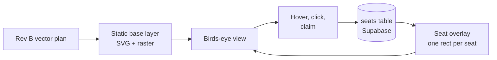

# The Hub at Lloyds Wharf — Build Plan

2026-09-22

Unit 4, Second Floor. Source drawing: Proposed Plans Unit 4 Lloyds Wharf Rev B.
Working assets: `/mnt/c/Users/puror/lloyds-wharf-hub/`

---

## 1. What is already proven

The Rev B drawing is live vector geometry, not a scan, so the digital twin is an
extraction job rather than a modelling job. That is the single biggest saving
available on this project.

| Measure | Value |
| --- | --- |
| Source geometry | 1,345 lines + 1,240 curves = 6,670 segments |
| Sheet | A1, 2384 x 1684 pt |
| Drawing scale | 1:50, or 56.69 pt per metre |
| Floorplate extent | 31.71 m x 18.02 m |
| Wall grid | two families at about +9° and -9°: the building is a wedge, not a rectangle |
| Structural segments, over 2.6 m | 51 |
| Partition segments, 0.8 to 2.6 m | 354 |
| Detail segments, under 0.8 m | 6,256 |

### How the scale was confirmed

Two independent routes agree. A1 at 1:50 gives 20 mm per metre, which is 56.69 pt.
Separately, the modal segment length in the drawing is 68.0 pt, appearing 37 times,
paired with a 34.4 pt family also appearing 37 times. At 56.69 pt/m those measure
1.199 m x 0.607 m, and the drawing annotates those exact rectangles 1.2000 and
0.6000. They are standard 1200 x 600 desks.

The 1.2 m match is within 0.1 percent. Treat 56.69 pt/m as locked. Expect about 1
percent variance on drawn detail edges against the annotated dimension, which is
line offset in the drawing, not scale error.

### The rendering decision this forces

405 segments carry the readable plan. The other 6,256 are invisible at screen size.
Do not ship all 6,661 as live interactive SVG, because it will not survive mobile.
Ship structure plus partition as live vector and bake the detail layer to a static
raster underlay. That is a 16x reduction in live DOM for no visible loss at
birds-eye zoom.

### Palette, sampled from the footage

Taken from 29 frames of the walkthrough, so this is how the building actually
photographs rather than an invented scheme.

| Role | Hex |
| --- | --- |
| Oak herringbone floor | #A48F7C |
| Oak, lit | #C8B7A8 |
| Timber beam, deep brick | #664F32 |
| Stock brick, mid | #8D7558 |
| Stock brick, sunlit | #F2DEB3 |
| Black steel column and frame | #342D2F |
| Acoustic panel near-black | #0F0E12 |
| Grey steel | #72747E |
| White desk and plaster | #E0DDDC |
| Daylight through arched window | #7E8EB1 |

The accent yellow still needs a decision. The pedestals measure #786000 to #846C00
in the footage, but that is interior underexposure rather than the paint. Normalised
to full value it sits near #E3B400. Get the real RAL or a daylight photo before
locking it, because this is the one brand colour that should not be guessed from video.

### Assets staged

| Path | Contents |
| --- | --- |
| assets/plan/floor_unit4_l2.svg | metric SVG, viewBox in metres, three layers |
| assets/plan/plan_meta.json | scale, bounds, grid angles |
| assets/plan/segs_raw.json | all 6,670 segments |
| assets/video/still_001-113.jpg | 2 fps extraction from the walkthrough |
| assets/brand/ | the cleat wall photograph |
| tools/ | the extraction scripts, re-runnable on the next drawing |

The SVG viewBox is in metres, origin at the drawing top-left, y increasing downward.
Seat coordinates, camera path and wall extrusion all use those same metric
coordinates. One coordinate system, no conversions anywhere downstream.

---

## 2. The seat picker

A visitor sees the floor from above, moves the cursor over it, and each desk lights
as they pass. They click one, type their name, and it is theirs. Everyone else
looking at the page sees that desk go dark in the same second.

That last sentence is the whole product. A floor plan with hover states is a
graphic. A floor plan where the seats are really taken is a booking system.

### Do not make the CAD drawing clickable

This is the mistake to avoid up front. The extracted SVG is a drawing, so its paths
are desk edges, chair arcs, dimension ticks and hatching, with no notion of a desk
as an object. Trying to attach click handlers to CAD paths produces fragile hit
areas that break the moment the drawing is revised.

Instead, the plan is scenery and the seats are data.

The overlay is generated from the seat registry, so a seat is a row with metric
coordinates, not a path in a drawing. Rev C arrives, the base layer is re-extracted
in minutes, and every seat keeps its identity.

### The seat registry

| Column | Type | Purpose |
| --- | --- | --- |
| id | text | stable key, survives redrawing |
| floor | text | unit4-l2 for now, more floors later |
| label | text | what a human calls it, such as Window 3 |
| x_m, y_m | numeric | seat centre in plan metres |
| rot_deg | numeric | which way the desk faces |
| zone | text | window, core, meeting, breakout |
| kind | text | fixed desk, hot desk, private office |
| status | text | available, held, taken, not bookable |
| occupant_name | text | shown on the seat when taken |
| price_pcm | numeric | drives the panel on selection |

Status needs three states rather than two. A seat that someone is mid-checkout on is
neither free nor sold, and without a held state two people will pay for the same
desk. Hold it for ten minutes at click, release on timeout.

### Naming the seats

Auto-numbering produces Desk 1 to Desk 37, which nobody can find in the room. Name
them after what you can see from them, because the walkthrough shows the landmarks
people will actually use: the arched window, the cast-iron column, the black
acoustic wall, the station clock, the pink sofa.

Window 1 to 6, Clock 1 to 4, Column bay, and so on. It costs an afternoon and it is
the difference between a seat map people navigate and one they squint at.

### The authoring tool comes first

Automated desk detection found 13 clean rectangles out of roughly 37. The gap is
chairs overlapping desk edges, shared benches drawn as one run, and dimension lines
crossing furniture. Chasing a perfect parser for a single one-off drawing is a week
with no guaranteed end.

Build a small internal page instead. The plan loads, a click drops a seat marker,
arrow keys nudge it, a field names it, and the result exports as the seats table.
Auto-detection seeds it with the 13 it is sure about, a person places the rest in
about an hour, and the output is correct by construction rather than correct by hope.

That tool is also how every future floor gets added, so it is infrastructure, not a
workaround.

### What makes it feel alive

Supabase Realtime on the seats table, subscribed by every open page:

- A seat turning amber the instant another visitor holds it, then red on payment, with no refresh
- A soft count somewhere on the page, such as nine desks left on this floor
- Cursor presence, so you can see that someone else is looking at the floor right now

Without this the page is a brochure. With it, the building is transmitting.

---

## 3. Binding the video to the plan

Matching the plan to the video means one thing in practice: at every moment of the
walkthrough, the system knows where the camera stood and which way it faced. Once
that exists, everything else falls out of it.

- Click a desk on the plan, and the video jumps to the second that desk is on screen.
- Scrub the video, and a marker slides along the plan with a cone showing the view.
- Pause anywhere, and the desks visible in that frame are highlighted on the plan beside it.

That is the feature. It is also the thing no coworking template can copy, because it
needs this drawing and this footage.

### The camera path

The footage is 56.4 seconds at 30 fps. It does not need 1,691 camera poses, it needs
about 20, with interpolation between them.

| Field | Meaning |
| --- | --- |
| t | seconds into the clip |
| x_m, y_m | camera position in plan metres |
| heading_deg | direction of view in plan degrees |
| fov_deg | roughly 65 for a phone at 720x1280 |

### Tag it by hand, not with SLAM

Running structure-from-motion over the clip is the obvious instinct and the wrong
call here. Indoor footage with repeating herringbone flooring, large plain brick
faces and plain white desks is close to the worst case for feature matching, and
720p handheld with motion blur makes it worse. It will either fail or drift, and
diagnosing which is a day you do not get back.

Twenty hand-tagged poses take about two hours in a tool that shows the frame and the
plan side by side. The landmarks are unmistakable: the arched window, the black
fluted acoustic wall, the cast-iron column, the station clock, the pink sofa.

Build the tagging tool as a second mode of the seat authoring tool.

### The aspect problem, stated plainly

The clip is 720 x 1280 portrait, handheld, 56 seconds. Good footage of the right
building, wrong shape for a full-bleed desktop hero.

| Option | Cost | Result |
| --- | --- | --- |
| Reshoot landscape on a gimbal | half a day plus access | best result; moves can match a scripted camera path |
| Keep portrait, frame it deliberately | none | the clip lives in a slab inside the 3D scene |
| Stills only for now | none | 113 frames already extracted and usable |

The current clip is enough to build and prove the entire binding. Do not wait for a
reshoot to start.

---

## 4. Build order

**Ship the seat picker before the cinematic opening.** This is the main
recommendation in this document and it runs against the natural instinct.

The cinematic is the thing everyone wants to build first, and it is the thing that
eats the budget. It is also the part that cannot be validated: there is no metric
that tells you the 1857 sequence is working. The picker is the opposite. It converts
a visitor into a booking, it either works or it does not, and every piece of data it
needs is data the 3D twin will reuse. Build it first and the cinematic gets built on
a proven data model. Build the cinematic first and the picker gets whatever time and
money is left.

The opening is the wrapper. Wrap something that already works.

| Phase | Delivers | Depends on |
| --- | --- | --- |
| 0. Extraction | metric SVG, scale, palette, staged assets | DONE |
| 1. Authoring | internal tool to place and name seats; seats table populated | phase 0 |
| 2. Picker | birds-eye view, hover, click, claim, realtime status | phase 1 |
| 3. Binding | camera path tagged, bidirectional video and plan scrub | phase 1 tool, phase 2 view |
| 4. Twin | walls extruded from the 51 structural segments, Theatre.js camera, the 1857 opening | phase 2 data model |
| 5. Commerce | hold, checkout, seat becomes taken on payment | phase 2 |

Phases 3 and 5 both hang off phase 2 and do not block each other, so they can run in
parallel across two agents once the picker is standing.

### Phase 1 in detail, because it is next

1. Create the seats table in Supabase with the columns above, plus row level
   security so only the holder can release a held seat.
2. Build the authoring page: base plan renders from `floor_unit4_l2.svg`, click
   places a seat, arrow keys nudge by 0.05 m, a field sets label and zone, export
   writes rows.
3. Seed it by running the existing detector, which gives 13 confident desks, and
   place the remainder by eye against the walkthrough stills.
4. Walk the floor once with the tool open and correct anything the drawing got
   wrong.

Step 4 is not optional. The drawing is the proposed layout. What is installed is
what people are buying.

---

## 5. Stack decisions

| Technology | Decision | Reason |
| --- | --- | --- |
| Three.js + R3F + Drei | In | the world, the twin, everything spatial |
| TSL shaders | In | one shader source compiles to both WebGPU and WebGL |
| Theatre.js | In, studio stripped from production | the missing piece: a real timeline for the camera |
| GSAP | In | ScrollTrigger and SplitText earn their place |
| Motion | In | UI physics, gestures, the booking panel |
| Lenis | In, alone | one scroll smoothing layer only, never with ScrollSmoother |
| Supabase Realtime | In | makes the floor live rather than drawn |
| Stripe | In | phase 5 |
| Anime.js 4 | Cut | a third tweening engine beside GSAP and Motion |
| Curtains.js | Cut | see below |
| Rive | Hold | good for a stateful concierge, nothing in phases 1-3 needs it |
| Spline | Hold | fine for concept sketching, should not reach production |

### Why Curtains.js goes

Curtains turns DOM images and video into WebGL planes with shaders on them. That is
the right tool when there is no other 3D on the page.

There is other 3D on this page. With R3F already running, a video texture on a plane
with a custom material does the identical refraction and dissolve, inside the same
scene graph, sharing the camera and the postprocessing chain. Curtains would create
a second WebGL context that cannot composite with the first, which means the video
effect and the 3D building could never occupy the same shot. Since the entire
concept is the footage becoming the building, that is disqualifying rather than
merely redundant.

### Theatre.js, the one detail that matters

The studio package is an editor. Author the sequence with it, export the state as
JSON, and ship only the core package plus that JSON to production. Import the studio
in a production bundle and every visitor downloads an animation editor they cannot
see. Write this into the build config as a hard rule.

### WebGPU needs a stated fallback

TSL compiles to both WGSL and GLSL, so materials are safe either way. The WebGPU
postprocessing pipeline is not equally portable, so bloom, depth of field and grain
need a WebGL path or the site renders black for a meaningful slice of visitors.

Make working on WebGL2 a release gate, not an aspiration.

### One rule for every agent on this

The libraries above are a toolbox, not a checklist. Nothing gets added to the bundle
without a named job in a named phase. If two of them can do the job, the one already
in the bundle wins.

---

## 6. Open items and risks

### Needed from you

- [ ] **Drawings for the other floors and units.** Rev B covers Unit 4 Second Floor only.
- [ ] **The accent yellow.** A RAL code, or a photograph of a pedestal in daylight.
- [ ] **A decision on the two named tenants.** The drawing labels ACG Offices and Iffy's.
- [ ] **Whether a landscape reshoot is happening.** Changes phase 3 and 4 scheduling.

### Risks

| Risk | Severity | Mitigation |
| --- | --- | --- |
| Drawing and building disagree | High | walk the floor in phase 1 step 4; treat what is installed as truth |
| Cinematic absorbs the budget | High | the build order exists for this reason; the picker ships first |
| WebGPU postprocessing fails silently | Medium | make WebGL2 a release gate |
| Portrait footage forced into a wide hero | Medium | pick one of the three options before phase 4 |
| Double booking on a seat | Medium | three-state status with a timed hold, never two-state |

### On the 1857 question

The wall in the entrance photograph reads ESTD 1857 and so does the cleat mark. The
historical research points at 1859 for the Lloyd and Sons occupancy. Both are
defensible, but they cannot both be on screen. Opening on 1859 while the hero asset
says 1857 is a contradiction in the same shot.

Use 1857. It is cast into the building, it is already in the logo, and a date the
visitor can walk up and touch beats a date from an archive.

A related note on the mark itself: it is a mooring cleat, a wharf fitting for tying
a boat fast. The tin-box history is a good footnote, but the cleat is what the
building owns, and it already means the thing the Hub is for.

**Things dock here.**
