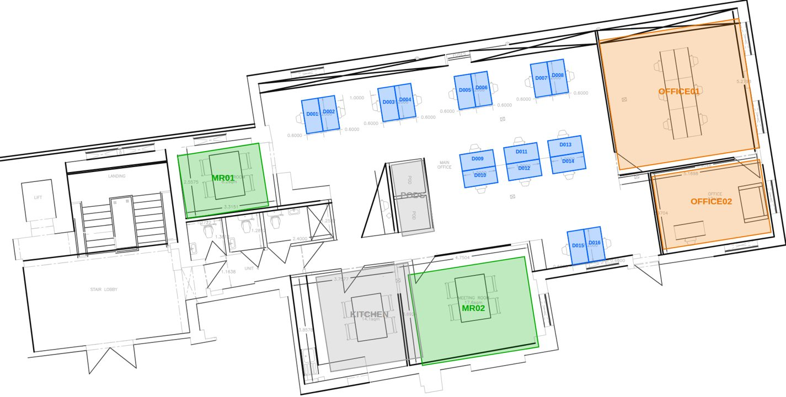
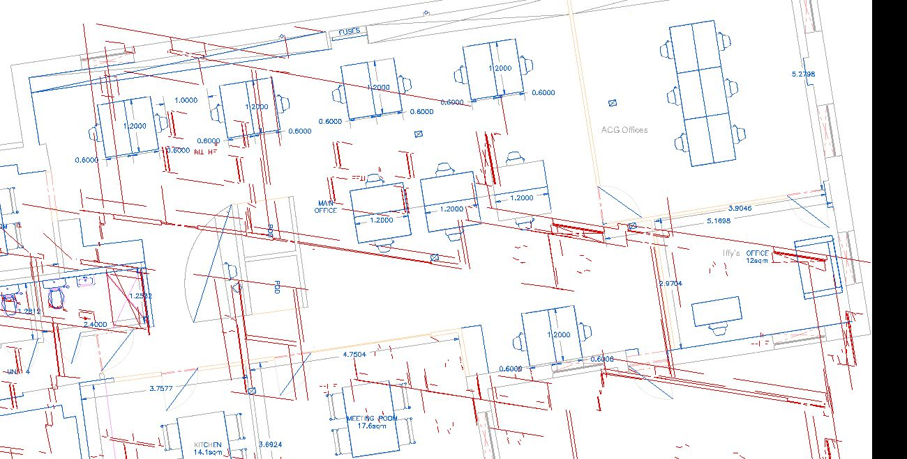

# Inventory: stable IDs on the real floor

`data/inventory/unit4-l2.json` is the registry of everything on Unit 4, Second Floor that
can be booked, or that the floor picker needs to draw. It holds **identity and geometry
only**. Prices, availability, holds, bookings and occupants live in the database and are
joined by ID.

Status: **DRAFT.** The drawing geometry comes from Rev B; the main-office grouping was
corrected from the operator's photographs on 28 September 2026. Nobody has walked the floor
with it yet (BUILD_PLAN §2, step 4). What is installed is what people are buying.



## What is in it

| ID | Label (provisional) | Kind | Capacity | Bookable | Source |
| --- | --- | --- | --- | --- | --- |
| `L2-D001`–`L2-D009` | Wall 1–9; three stations toward Private Office 1, each containing exactly two vertical tables and one horizontal bottom table with left/front/right chair positions | desk | 1 each | yes | operator close-up and placement correction on 28 Sep 2026, aligned to the Rev B grid |
| `L2-D010`–`L2-D019` | Centre 1–10; one continuous double-sided five-by-two bench | desk | 1 each | yes | operator close-up on 28 Sep 2026, aligned to the Rev B grid |
| `L2-MR01` | Meeting room (small), 8.2 m² | meeting_room | 4 | yes | drawing annotation |
| `L2-MR02` | Meeting room (large), 17.6 m² | meeting_room | 8 | yes | drawing annotation |
| `L2-OFFICE01` | Private office 1 (drawing says "ACG Offices", 6 desks) | private_office | 6 | **no, pending D6** | drawing annotation |
| `L2-OFFICE02` | Private office 2 (drawing says "Iffy's", 12 m², 1 desk) | private_office | 1 | **no, pending D6** | drawing annotation |

Spaces (not bookable): main office, meeting zone, office suite, kitchen (14.1 m²), two phone pods.

A desk's `kind` is just `desk`. Whether a desk is sold as a day pass or as a dedicated
monthly desk is a **commercial** decision made in `src/commerce/catalogue.ts`, not a property
of the geometry. The same desk can be a hot desk this month and dedicated next month without
changing its ID.

No event space is registered. The drawing has none; if the main office is to be hired out
for events, that becomes `L2-EVENT01` once the operator says so (ROADMAP D10).

## Rules

1. **An ID is never reused or renumbered.** Retire a unit with `"retired": true`. Bookings
   made against it stay valid history.
2. IDs carry no meaning beyond floor + kind + number. Labels are for humans and will change
   after the floor walk ("name them after what you can see from them": BUILD_PLAN §2).
3. Coordinates are plan metres, the same system as `assets/plan/floor_unit4_l2.svg`.
   `x_m`, `y_m` is the centre; `footprint` is the hit area polygon; `rot_deg` is the long axis.
4. The CAD paths are never clickable. The picker draws `footprint` polygons over the plan.
5. A footprint is a booking hit area as well as the measured outline of its physical table.
   The picker renders the wall stations as exactly three separate pieces and unions the ten
   touching centre footprints into the continuous bench seen in the photographs. Availability
   sits on the corresponding chair marker, so it never invents extra coloured furniture.

## How it is built

```bash
python3 tools/detect_desks.py      # proves every 2:1 desk rectangle in the Rev B segments
python3 tools/build_inventory.py   # assigns IDs, adds rooms, writes the registry
```

`build_inventory.py` refuses to run if the detector's count per zone changes, then applies
the photographed 19-desk main-office grouping on the same measured grid. A new drawing can
therefore never silently shift or renumber the corrected layout.

Room footprints are read from the drawing's dimension strings and placed by eye on a metric
grid. They are accurate to about ±0.2 m, which is enough for a hit area. The seat authoring
tool (ROADMAP C1.5) is where they get corrected.

## The extraction bug this uncovered (fixed 23 Sep)



The first extraction read PDF lines with bottom-up coordinates and curves top-down. Walls
(lines) came out mirrored against furniture and labels (curves). That is why the old SVG
looked fragmentary. `tools/extract.py` now uses top-down points for both, and the SVG,
`plan_meta.json` and `segs_raw.json` were regenerated. Nothing in `src/` read the old
coordinates.
